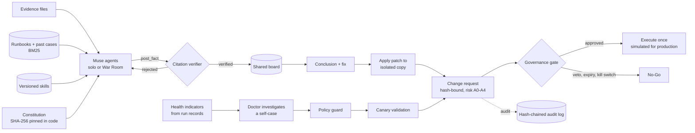

# IncidentLens

**Evidence-first incident investigation with governed self-repair, built on Meta Muse.**

IncidentLens investigates production incidents in Java/Spring Boot services on Kubernetes. A team
of Muse agents reads the logs, traces, Kubernetes state, config, code and recent changes, and
agrees on a root cause. Nothing an agent claims is taken on trust: every quote is checked against
the source, every patch is applied to an isolated copy, and every change, including changes
IncidentLens makes to itself, goes through a governance gate that the AI cannot approve or bypass.

> **Status, 2026-11-04.** Every feature below is implemented and covered by 69 automated tests
> (CI on every push), which use a scripted stand-in model. **First live Muse evaluation,
> 2026-11-04**, on `muse-wonder-1.0` and `muse-spark-1.3`, one run per incident:
> - Solo mode found the root cause in 5 of 5 incidents, War Room mode in 5 of 5.
> - All 109 citations in the final reports were verified.
> - The War Room put one fix in a different file than the answer key (4 of 5).
> - Both suites together cost $4.22.
>
> That is n = 1 on five incidents written by the authors, not a benchmark: see
> [live results](docs/EVALUATION_PROTOCOL.md#live-results-2026-11-04). The offline demo uses a
> scripted model, labelled as such. [docs/IMPLEMENTATION_GAP_MATRIX.md](docs/IMPLEMENTATION_GAP_MATRIX.md)
> says exactly what is verified, simulated, partial or missing.

## What it does

1. **Investigates.** Solo mode runs one agent. War Room mode runs six: a Commander and a Skeptic
   on `muse-wonder-1.0` (deep reasoning), Signals, Platform and Code specialists on
   `muse-spark-1.3` (fast), and a Fixer. They share a board, ask each other for help, and work
   to priorities. A mid-incident update ("duplicate charges still happening"; scripted in the
   test incidents) pauses lower-priority work so the team mitigates first, the way an incident
   commander would.
2. **Refuses quotes it cannot find.** Facts enter the shared board only if their quote is found in
   the cited file at the cited lines, so one agent's hallucination cannot become another agent's
   premise. The Commander cannot conclude until the Skeptic has tried to disprove the leading
   hypothesis. A verified citation proves the quote is real, not that the conclusion is right:
   causal reasoning is judged by the Skeptic, by the hidden-answer-key score in evaluation, and by
   the humans approving the fix. Claim-level verification is issue #6.
3. **Proves the fix applies.** The proposed unified diff is applied to an isolated in-memory
   copy of the file. The evidence on disk is never written.
4. **Governs every change.** Each fix becomes a change request bound to the SHA-256 of the
   exact change and classified by risk. A production code change (A3) needs two different human
   approvers, a veto or expiry always wins, the requester can never approve its own change, and
   a kill switch stops everything except rollbacks. Execution of production changes is simulated.
5. **Repairs itself, within limits.** IncidentLens measures its own investigations. When an
   indicator breaches its objective, a Doctor agent investigates IncidentLens with the same
   evidence rules, and proposes a rollback or a minimal skill patch. Patches pass a policy guard,
   are validated on canary incidents scored against answer keys the Doctor cannot read, and then
   wait for human approval. Approved versions go live on the next run with no restart. The
   Doctor can only change skills (prompts and runbooks), never its constitution, verifier,
   policies, tools, scoring or code.
6. **Keeps working when a model fails.** If Muse Wonder fails, calls fail over to Muse Spark and a
   circuit breaker routes around Wonder until it recovers. The report names the model that
   actually answered, and each failover or quarantined injection becomes a hash-chained Evolution
   Ledger entry that proposes an improvement. Shown live with an injected outage:
   [docs/CONTINUITY_DEMO.md](docs/CONTINUITY_DEMO.md).

IncidentLens improves the system around Muse (skills, retrieval, routing, verification). It does
not change Muse's model weights.

## Run it

Requires Node 24 or newer. There are no runtime dependencies to install.

```powershell
npm test                 # 69 tests: verifier, War Room, governance, self-repair, access, guards, security, continuity, provenance
npm run demo:offline     # full UI with a scripted model (no API key; inc-001 only), http://localhost:5173
npm start                # live, with Muse: needs MODEL_API_KEY and working Meta billing
npm run eval             # score solo mode on all incidents (add --warroom for War Room mode)
npm run sentinel:smoke   # 21 offline security scenarios; exits 1 while findings are open (docs/SECURITY_ASSURANCE_FINDINGS.md)
```

The offline demo is labelled `scripted-... (offline demo, not Muse)` everywhere it appears, and
keeps its state in `data-offline-demo/` and `runs-offline-demo/`.

| Variable | Default | Purpose |
|---|---|---|
| `MODEL_API_KEY` | | Meta Model API key. Never logged, never written to disk. |
| `MODEL_DEEP` / `MODEL_FAST` | `muse-wonder-1.0` / `muse-spark-1.3` | Model per tier |
| `LLM_WIRE` | `responses` | `responses` or `messages` (both served by the Meta Model API) |
| `REASONING_DEEP` / `REASONING_FAST` | `high` / `low` | Reasoning effort; `off` disables. Dropped automatically if the endpoint rejects it |
| `WARROOM_CONCURRENCY` | `3` | Agents working in parallel |
| `WARROOM_MAX_COST_USD` | `3` | Per-investigation budget; when reached, the Commander must conclude |
| `ACCESS_SECRET` | | 32+ characters. Turns on access codes for live runs |
| `HOST` | `127.0.0.1` without a secret | The server refuses to listen beyond loopback without `ACCESS_SECRET` unless `INCIDENTLENS_DEV_OPEN=1` |

Access codes for a hosted demo: `ACCESS_SECRET=... npm run mint-token -- --name judge-1 --days 7 --runs 20`
(add `--role admin` for self-repair, fault injection and approvals). Recorded runs and read-only
views stay public. Live investigations need a code and count against its run budget.

## How it works



| Module | Responsibility |
|---|---|
| `src/llm.ts` | Muse client: Responses and Messages wires, fast/deep tiers, circuit breakers, failover, Retry-After, parameter negotiation, cost metering |
| `src/agent.ts`, `src/loop.ts` | Solo investigator and the shared tool loop |
| `src/warroom/` | Shared board, role tools, priority scheduler with pause and resume |
| `src/verify.ts`, `src/sandbox.ts` | Citation verification, patch line check, patch application to an isolated copy |
| `src/governance/changes.ts` | Change requests, approval precedence, veto, expiry, kill switch, execution |
| `src/heal/` | Health indicators, self-case builder, Doctor, deterministic rollback rule, seeded regression |
| `src/skills/` | Versioned skill registry and BM25 retrieval |
| `src/guard/` | Constitution pin, policy guard for self-changes, injection quarantine, audit log |
| `src/access.ts`, `src/server.ts` | Access codes, roles, budgets, HTTP API and security headers |

## Incidents

Five synthetic incidents, each with red herrings and a hidden answer key that the agents' tools
cannot read (enforced and tested).

| Incident | Real cause | Distractors |
|---|---|---|
| Checkout 5xx, p99 above 30s | Fraud HTTP call moved inside `@Transactional`, exhausting the Hikari pool | GC pauses, readiness failure, autoscaling |
| Pods restarting | Memory limit cut to 1024Mi while `-Xmx1024m` stayed, so the kernel OOM-kills the JVM | Slow-query warnings, batch job |
| Customers charged twice | Retry on read timeout for a non-idempotent `POST /v1/charges` with no idempotency key | Ledger lag, batch-size change |
| Inventory oversold | Producer added `loyaltyTier`; the consumer's own `ObjectMapper` rejects unknown fields | ERP sync slowness, retention change |
| Intermittent 503s | Readiness probe on aggregate `/actuator/health` (includes Redis) with a 1s timeout, during a Redis migration | Hundreds of harmless 404s, a planted prompt injection in the logs |

## Limits, stated plainly

- Every incident here is synthetic, and every screen says so. Each record also says whether a
  live Muse model or a scripted one answered, and names any simulated fault. Records made
  before 2026-11-04 13:30 ET carry no such label and are shown as "source not recorded".
- A verified citation proves the quoted text exists at the cited lines. It does not prove the conclusion drawn from it.
- Live Muse results so far are one run per incident on five incidents written by the authors,
  scored by keyword groups. They show the system works end to end on Muse; they are not a
  benchmark, and there is no baseline yet. On these incidents the War Room was no more accurate
  than solo mode and cost about four times as much.
- Remediation execution is simulated. Patches are applied to an isolated copy, but not compiled
  or tested.
- Prompt-injection detection is a pattern-based alert, not a guarantee. Safety comes from the
  agents having read-only tools and from the governance gate.
- State lives in JSON files with atomic writes in a single process. There is no multi-instance
  locking, and access codes cannot yet be revoked.
- Retrieval is lexical (BM25). The Meta Model API has no embeddings endpoint.

More: [architecture](docs/ARCHITECTURE.md), [governance](docs/GOVERNANCE.md),
[self-evolution](docs/SELF_EVOLUTION.md), [evaluation protocol](docs/EVALUATION_PROTOCOL.md),
[Sentinel gap matrix](docs/SENTINEL_GAP_MATRIX.md), [decisions](docs/DECISION_LOG.md),
[threat model](docs/THREAT_MODEL.md), [roadmap](docs/ROADMAP.md) (issues #1–#16),
[demo script](docs/DEMO_SCRIPT_3_MIN.md).

## License

[MIT](LICENSE)
