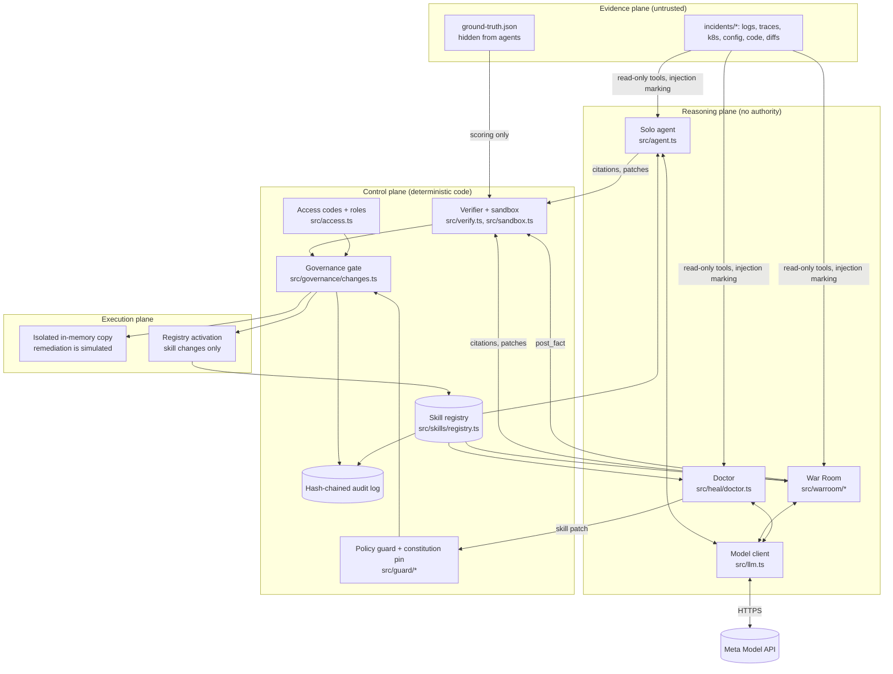

# Architecture

Part 1 describes what exists in this repository today. Part 2 describes the target from the
specification; nothing in Part 2 should be read as implemented. Capability status with test
evidence: [IMPLEMENTATION_GAP_MATRIX.md](IMPLEMENTATION_GAP_MATRIX.md) and
[SENTINEL_GAP_MATRIX.md](SENTINEL_GAP_MATRIX.md).

## Part 1 — As built

**Merged but not wired into the running application:** `src/continuity/router.ts` is an
isolated, provider-neutral continuity prototype added in [PR #22](https://github.com/SandeepSubbiah/incidentlens/pull/22).
It is unit-tested for policy-restricted routing, deadlines, circuit breakers, committed-output
rejection, stale completion handling and telemetry isolation. The live `src/llm.ts` model
client still owns the existing same-provider failover mechanism. There is no production
cross-provider failover, multi-instance control plane, or seamless stream restoration.
See [feature status](FEATURE_STATUS.md) and [continuity limits](CONTINUITY_PROTOTYPE.md).


One Node.js 24 process, TypeScript run directly, no runtime dependencies. The only outbound
network calls go to the Meta Model API (`MODEL_BASE_URL`, default `https://api.meta.ai`). State
is kept in JSON files under `data/` (registry, governance ledger, audit log, learned cases,
access usage) and run records under `runs/`.



### Components

| Component | Responsibility | Trust |
|---|---|---|
| `src/incidents.ts` | Case loading, path containment (lexical and real-path), hidden files | Enforces the evidence boundary |
| `src/tools.ts` | Read-only tools: list, read, search artifacts; search runbooks; marks instruction-like lines | Agents can read, never write |
| `src/llm.ts` | Responses and Messages wires, fast/deep tiers, breakers, failover, Retry-After, parameter negotiation, cost | Billing and auth errors are never retried |
| `src/agent.ts`, `src/loop.ts` | Solo investigator; shared tool loop | Proposes only |
| `src/warroom/*` | Six roles, shared board, priority scheduler with pause and resume | Board accepts evidence only through the verifier |
| `src/verify.ts` | Quote location check; patch line check | Deterministic |
| `src/sandbox.ts` | Applies a unified diff to an in-memory copy | Never writes evidence |
| `src/governance/changes.ts` | Change requests, precedence rules, execution, compensation, recovery | The only path from proposal to effect |
| `src/guard/*` | Constitution pin, policy guard for AI-authored skills, injection patterns, audit chain | Outside the model |
| `src/skills/*` | Versioned skills, BM25 retrieval, case memory | AI can propose skill versions; only governance activates them |
| `src/heal/*` | Health indicators, self-case, Doctor, reflex rule, seeded regression | Proposes; cannot approve |
| `src/access.ts`, `src/server.ts` | HMAC access codes, roles, budgets, rate limit, headers, HTTP API | Fails closed when exposed without a secret |

### Trust boundaries in code

1. **Evidence → model.** Agents read evidence through tools that refuse hidden files, traversal
   and symlink escapes, and mark instruction-like lines as untrusted. Evidence never becomes a
   system instruction. The marking is an alert, not a guarantee (`test/guard.test.ts`).
2. **Model → board.** The War Room board accepts a fact only after its quote is located in the
   cited file (`test/warroom.test.ts`).
3. **Model → effect.** No agent has a write tool. Effects happen only through
   `src/governance/changes.ts` (`test/governance*.test.ts`).
4. **Proposer → approver.** Approver identity comes from a signed access code, never from model
   text; the requester cannot approve (`test/access.test.ts`, `test/governance.test.ts`).
5. **Self-repair → core.** Skills are the only mutable surface; the constitution is pinned in
   code; the policy guard runs before any AI-authored version is stored (`test/skills.test.ts`).
6. **Candidate → grader.** Validation scores against answer keys the Doctor's tools cannot read
   (`test/core.test.ts`, `test/heal.test.ts`).

### Known architectural limits

- Single process. Serialization is in-process; two processes writing the ledger concurrently
  could lose updates. Restarts are handled (`test/governance-races.test.ts`); concurrent
  instances are not.
- JSON files, not a database. Atomic rename writes, no transactions across files.
- The audit chain detects edits but not truncation of the newest entries by someone with file
  access.

## Part 2 — Target (from the specification, not built)

```
authorized sources -> ingestion with provenance, ACL, redaction, trust tiers
  -> versioned evidence store and hybrid retrieval (lexical + semantic + code graph)
  -> incident/task manager and typed hypothesis graph
  -> model router (Muse Wonder / Muse Spark / provider adapters)
  -> specialists -> skeptic -> independent claim verifier
  -> policy decision point (OPA or equivalent) + durable decision ledger
  -> sandboxed build/test -> preflight -> canary -> monitored execution
  -> outcome verification -> compensation/rollback
  -> learning ledger -> candidate generator -> independent evaluator -> release gate
```

Planned additions, in dependency order, are tracked as GitHub issues labelled `phase-p`:
durable store (PostgreSQL with outbox), identity and tenant isolation, isolated patch
executor, live evaluation baseline, Sentinel scenario registry, claim verifier and focus
governor, completed approval state machine, RAG provenance, staged self-evolution, cloud
posture importers, insider-risk workflow, decoy layer, provider adapters with OpenTelemetry,
supply-chain scanning. See [ROADMAP.md](ROADMAP.md) and [SENTINEL_GAP_MATRIX.md](SENTINEL_GAP_MATRIX.md).
