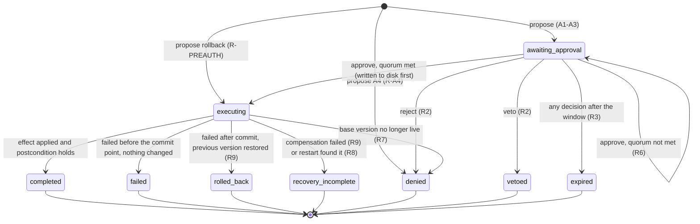

# Governance

How a proposal becomes an effect, as implemented in `src/governance/changes.ts` (policy
`policy-2026-11-04.1`). Tests: `test/governance.test.ts`, `test/governance-races.test.ts`,
`test/access.test.ts`, `test/heal.test.ts`, `test/seed.test.ts`.

## Principle

The model proposes; deterministic code decides. No prompt, skill or agent output is consulted
when deciding whether a change may run. Approver identity comes from a signed access code.

## Actors (implemented)

| Actor | Identity source | Can propose | Can approve | Can reject or veto | Kill switch |
|---|---|---|---|---|---|
| Incident agents (`incidentlens:solo`, `incidentlens:warroom`) | Fixed requester name in code | Remediations (A3) | No | No | No |
| Doctor (`doctor`, `doctor:reflex`) | Fixed requester name in code | Skill changes (A1), rollbacks | No | No | No |
| Policy | `POLICY.preauthorized` | — | Rollbacks only, recorded as actor `policy` | — | — |
| Judge | Access code with `role: judge` | — | No | Yes | No |
| Admin | Access code with `role: admin` | — | Yes, never their own request | Yes | Yes |
| Local operator | Open mode on loopback only: one identity, `local`, role admin | — | Yes | Yes | Yes |

Not implemented (specification roles): developer, service owner, SRE, security officer,
compliance owner, incident commander, break-glass. One local identity cannot satisfy a
two-person rule, which is intended.

## Risk classes

| Class | Meaning here | Approvals | Execution |
|---|---|---|---|
| A0 | Read-only | 0 | — (agents' tools are all read-only) |
| A1 | Change to IncidentLens's own skills | 1 distinct admin | Live: registry activation |
| A2 | Staging change | 1 | Not used yet |
| A3 | Production code change from an incident | 2 distinct admins | Simulated: patch applied to an isolated copy |
| A4 | Privileged, financial, destructive, irreversible | — | Prohibited at proposal (R-A4) |

Approval windows: A1/A2 240 minutes, A3 120 minutes.

## Precedence (evaluated in this order on every decision)

| Rule | Check | Outcome |
|---|---|---|
| R-404 / R-FINAL | Request exists and is still awaiting approval | Refused otherwise; terminal states are final |
| R1 | Kill switch on (approvals only; serialized with decisions) | Refused, nothing recorded |
| R3 | Approval window expired | Request becomes `expired`; refused |
| R4 | Submitted hash differs from the request's hash | Refused: approval binds to the exact change |
| R-ROLE | Approve needs admin; reject/veto need admin or judge | Refused |
| R5 | Requester approving its own request, or an approver approving twice | Refused |
| R2 | Veto or reject recorded | `vetoed` or `denied`; no later decision applies |
| R6 | Distinct approvers ≥ required | Execute (below); otherwise keep waiting |
| R7 | At execution: skill version the change was built on is no longer live | `denied`; propose again |
| R9 | At execution: failure after a partial commit | Restore previous version → `rolled_back`; if that fails → `recovery_incomplete` |
| R8 | At process start: request found in `executing` | `recovery_incomplete`; never re-run |
| R-PREAUTH | Rollback to a previously active version | Executes at proposal, also under the kill switch |
| R-A4 | A4 proposed | `denied` at proposal |

Every proposal, decision, refusal of a pending request, execution outcome and kill-switch change
is appended to the hash-chained audit log with the actor and rule. Refusals for unknown or
already-final requests (R-404, R-FINAL) are returned to the caller but not logged.

## State machine (exact)

Expiry is evaluated when a decision arrives, not by a background sweep. A request past its
window shows `awaiting_approval` until someone acts on it, and then becomes `expired`. It can
never execute.

## Rollback and recovery behaviour

| Change | Rollback | Verified by |
|---|---|---|
| Skill version | Pointer move to the previously active version; pre-authorized | `test/skills.test.ts`, `test/seed.test.ts` |
| Skill change that fails before commit | Nothing to undo; any stored version is inert | `test/governance-races.test.ts` |
| Skill change that fails after commit | Automatic restore of the previous version (R9) | `test/governance-races.test.ts` |
| Remediation | Nothing to roll back: execution is simulated on an isolated copy | `test/governance.test.ts` |
| Interrupted execution | Not re-run; flagged for a human (R8) | `test/governance-races.test.ts` |

## Real versus demonstration

- Skill changes and rollbacks really change IncidentLens's behaviour on its next run.
- Remediations never touch a real system. The UI labels them "execution simulated on an
  isolated copy".
- The fault-injection controls (outage, bad skill edit, seeded regression) are labelled as such,
  and seeded run records carry `synthetic: true`.

## Not implemented

Hold, release and revoke decisions; preflight, scheduling and suspend states; dependency graphs
between requests; break-glass; a background expiry sweep; multi-instance locking; revocation of
access codes. These are tracked as GitHub issues labelled `phase-p`.
